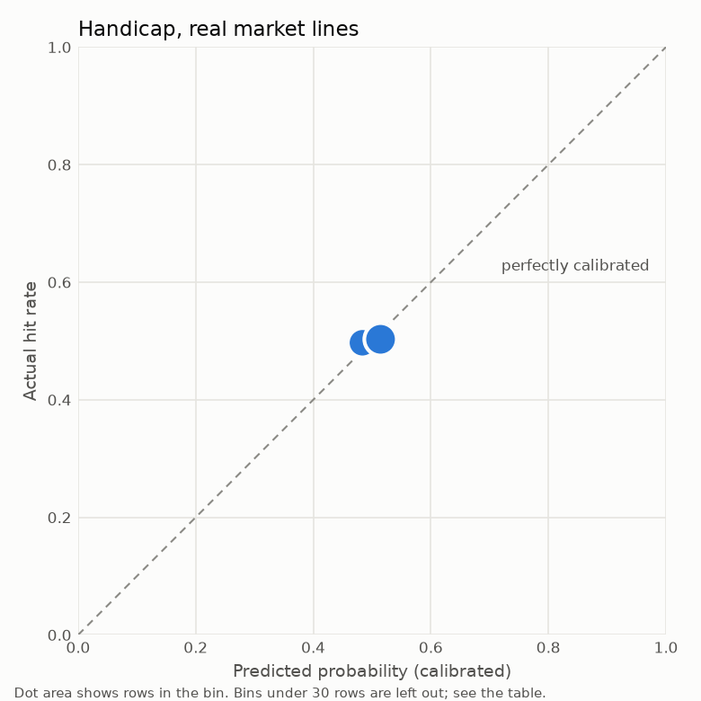
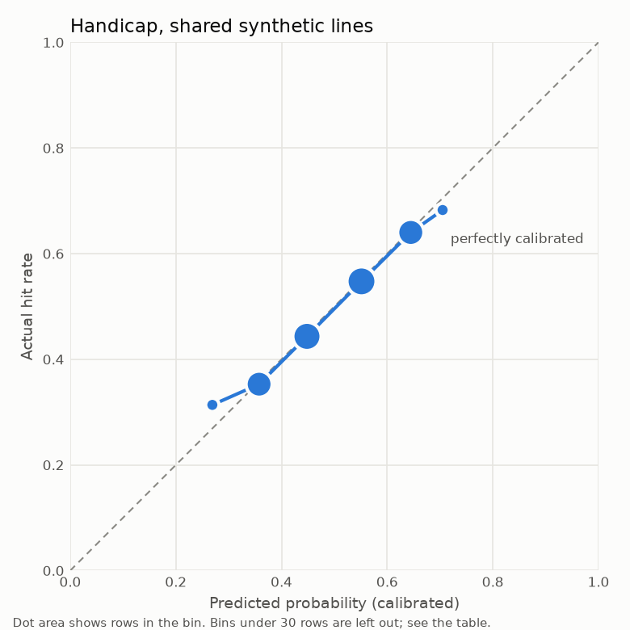
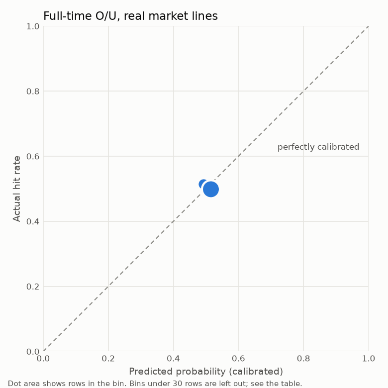
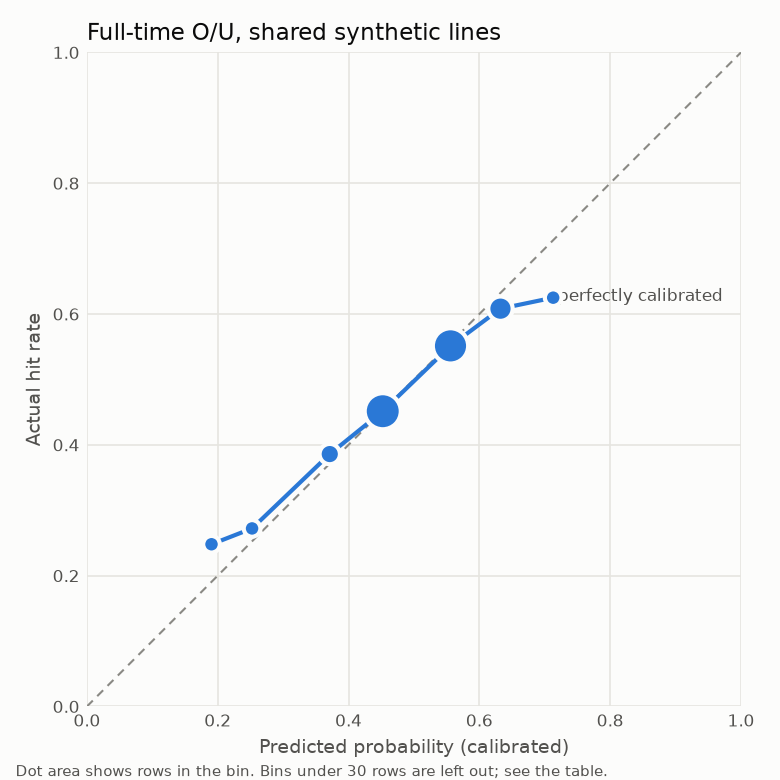
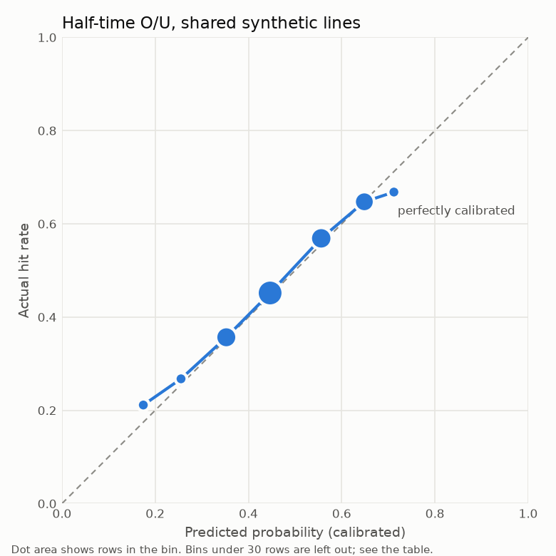
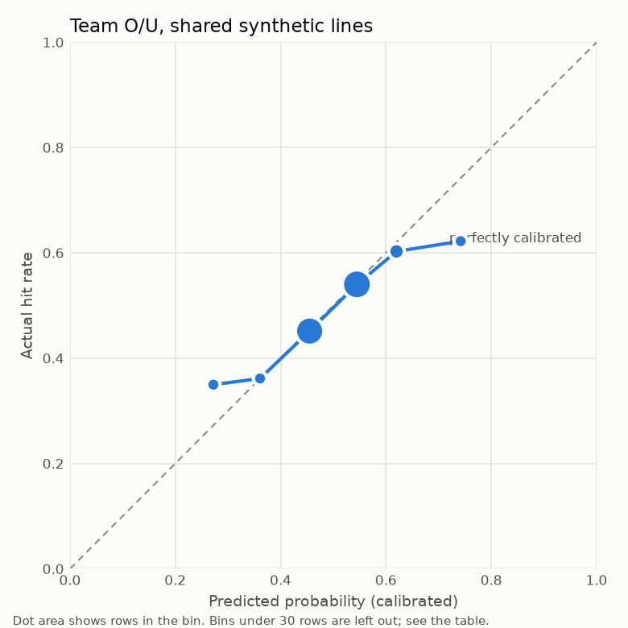

# Evidence: NBA

Generated by `hoopsedge.backtest.run` on 2026-11-06.

## Verdict

- **NBA Handicap:** does not beat baselines, on real market lines. Enabled anyway by owner override (D65). Gain: +0.0011 (-0.0000 to +0.0022).
- **NBA Full-time O/U:** does not beat baselines, on real market lines. Enabled anyway by owner override (D65). Gain: +0.0010 (-0.0001 to +0.0022).
- **NBA Half-time O/U:** does not beat baselines, on shared synthetic lines. Enabled anyway by owner override (D65). Gain: +0.0015 (-0.0015 to +0.0044).
- **NBA Team O/U:** does not beat baselines, on shared synthetic lines. Enabled anyway by owner override (D65). Gain: +0.0017 (+0.0000 to +0.0035).

A positive gain means the calibrated model has lower log loss than the ratings baseline on the same games and lines, taking the baseline raw or calibrated, whichever scored better. Intervals are 95% and resample whole games. The gate only compares the model with that baseline. Beating it isn't the same as beating the market, which the market comparison below measures.

## Data

| Period | Games | With a closing line |
|---|---|---|
| 2023-24 | 1319 | 1319 |
| 2024-25 | 1321 | 1320 |
| 2025-26 | 1322 | 1321 |
| 2026-27 start | 123 | 121 |

- Tuning and thresholds used only games before the first tested game.
- Validation ran from 2022-10-01 to 2023-07-01, refitting every 30 days through the tested games.
- No injury features are in V1 (D15), so availability news isn't reflected.
- Half-time and team totals have no historical lines, so any edge on them is unproven until live SportyBet logs build up (D18, D27).
- Real lines are ESPN book closing lines, not SportyBet prices, whose margin may differ.

## Score models, all tested games

| Period | Target | Candidate | Games | MAE | RMSE | CRPS | Log-lik. | Log-lik. gain vs baseline |
|---|---|---|---|---|---|---|---|---|
| ft | margin | model | 4083 | 11.21 | 14.362 | 8.022 | -4.0835 | +0.0067 (+0.0035 to +0.0099) |
| ft | margin | baseline | 4083 | 11.261 | 14.424 | 8.061 | -4.0902 | +0.0000 (+0.0000 to +0.0000) |
| ft | margin | elo | 4083 | 11.272 | 14.412 | 8.059 | -4.0892 | +0.0010 (-0.0027 to +0.0045) |
| ft | margin | prior | 4083 | 12.127 | 15.451 | 8.646 | -4.1602 | -0.0700 (-0.0805 to -0.0606) |
| ft | total | model | 4083 | 14.71 | 18.455 | 10.411 | -4.3356 | +0.0025 (-0.0010 to +0.0060) |
| ft | total | baseline | 4083 | 14.744 | 18.518 | 10.436 | -4.3381 | +0.0000 (+0.0000 to +0.0000) |
| ft | total | elo | 4083 | 16.27 | 20.476 | 11.508 | -4.4383 | -0.1002 (-0.1123 to -0.0873) |
| ft | total | prior | 4083 | 15.758 | 19.856 | 11.162 | -4.4076 | -0.0695 (-0.0797 to -0.0591) |
| h1 | margin | model | 4083 | 9.003 | 11.395 | 6.395 | -3.8523 | +0.0023 (-0.0008 to +0.0056) |
| h1 | margin | baseline | 4083 | 9.025 | 11.412 | 6.406 | -3.8546 | +0.0000 (+0.0000 to +0.0000) |
| h1 | margin | elo | 4083 | 8.964 | 11.31 | 6.355 | -3.8457 | +0.0089 (+0.0038 to +0.0144) |
| h1 | margin | prior | 4083 | 9.32 | 11.785 | 6.621 | -3.8871 | -0.0324 (-0.0408 to -0.0239) |
| h1 | total | model | 4083 | 9.708 | 12.175 | 6.863 | -3.9188 | +0.0013 (-0.0030 to +0.0053) |
| h1 | total | baseline | 4083 | 9.753 | 12.195 | 6.877 | -3.92 | +0.0000 (+0.0000 to +0.0000) |
| h1 | total | elo | 4083 | 10.27 | 12.872 | 7.256 | -3.974 | -0.0540 (-0.0648 to -0.0428) |
| h1 | total | prior | 4083 | 10.186 | 12.776 | 7.204 | -3.9666 | -0.0465 (-0.0559 to -0.0369) |

### By evidence period

| Evidence period | Period | Target | Candidate | Games | MAE | CRPS |
|---|---|---|---|---|---|---|
| 2023-24 | ft | margin | model | 1319 | 11.111 | 7.952 |
| 2023-24 | ft | margin | baseline | 1319 | 11.17 | 7.996 |
| 2023-24 | ft | margin | elo | 1319 | 11.144 | 7.968 |
| 2023-24 | ft | margin | prior | 1319 | 11.921 | 8.479 |
| 2023-24 | ft | total | model | 1319 | 14.664 | 10.298 |
| 2023-24 | ft | total | baseline | 1319 | 14.626 | 10.292 |
| 2023-24 | ft | total | elo | 1319 | 16.502 | 11.661 |
| 2023-24 | ft | total | prior | 1319 | 15.673 | 11.061 |
| 2023-24 | h1 | margin | model | 1319 | 9.016 | 6.414 |
| 2023-24 | h1 | margin | baseline | 1319 | 9.05 | 6.438 |
| 2023-24 | h1 | margin | elo | 1319 | 8.973 | 6.375 |
| 2023-24 | h1 | margin | prior | 1319 | 9.272 | 6.608 |
| 2023-24 | h1 | total | model | 1319 | 9.771 | 6.881 |
| 2023-24 | h1 | total | baseline | 1319 | 9.831 | 6.895 |
| 2023-24 | h1 | total | elo | 1319 | 10.5 | 7.405 |
| 2023-24 | h1 | total | prior | 1319 | 10.394 | 7.315 |
| 2024-25 | ft | margin | model | 1321 | 11.059 | 7.922 |
| 2024-25 | ft | margin | baseline | 1321 | 11.113 | 7.959 |
| 2024-25 | ft | margin | elo | 1321 | 11.153 | 7.975 |
| 2024-25 | ft | margin | prior | 1321 | 11.914 | 8.508 |
| 2024-25 | ft | total | model | 1321 | 14.546 | 10.308 |
| 2024-25 | ft | total | baseline | 1321 | 14.669 | 10.369 |
| 2024-25 | ft | total | elo | 1321 | 16.02 | 11.3 |
| 2024-25 | ft | total | prior | 1321 | 15.745 | 11.145 |
| 2024-25 | h1 | margin | model | 1321 | 8.862 | 6.296 |
| 2024-25 | h1 | margin | baseline | 1321 | 8.899 | 6.315 |
| 2024-25 | h1 | margin | elo | 1321 | 8.88 | 6.284 |
| 2024-25 | h1 | margin | prior | 1321 | 9.116 | 6.493 |
| 2024-25 | h1 | total | model | 1321 | 9.464 | 6.681 |
| 2024-25 | h1 | total | baseline | 1321 | 9.502 | 6.694 |
| 2024-25 | h1 | total | elo | 1321 | 9.992 | 7.05 |
| 2024-25 | h1 | total | prior | 1321 | 9.936 | 7.029 |
| 2025-26 | ft | margin | model | 1322 | 11.453 | 8.184 |
| 2025-26 | ft | margin | baseline | 1322 | 11.491 | 8.223 |
| 2025-26 | ft | margin | elo | 1322 | 11.48 | 8.211 |
| 2025-26 | ft | margin | prior | 1322 | 12.579 | 8.978 |
| 2025-26 | ft | total | model | 1322 | 14.911 | 10.609 |
| 2025-26 | ft | total | baseline | 1322 | 14.932 | 10.635 |
| 2025-26 | ft | total | elo | 1322 | 16.348 | 11.608 |
| 2025-26 | ft | total | prior | 1322 | 15.905 | 11.323 |
| 2025-26 | h1 | margin | model | 1322 | 9.124 | 6.462 |
| 2025-26 | h1 | margin | baseline | 1322 | 9.122 | 6.454 |
| 2025-26 | h1 | margin | elo | 1322 | 9.031 | 6.397 |
| 2025-26 | h1 | margin | prior | 1322 | 9.602 | 6.78 |
| 2025-26 | h1 | total | model | 1322 | 9.845 | 7.004 |
| 2025-26 | h1 | total | baseline | 1322 | 9.902 | 7.031 |
| 2025-26 | h1 | total | elo | 1322 | 10.322 | 7.322 |
| 2025-26 | h1 | total | prior | 1322 | 10.257 | 7.29 |
| 2026-27 start | ft | margin | model | 121 | 11.296 | 8.096 |
| 2026-27 start | ft | margin | baseline | 121 | 11.334 | 8.108 |
| 2026-27 start | ft | margin | elo | 121 | 11.687 | 8.299 |
| 2026-27 start | ft | margin | prior | 121 | 11.776 | 8.346 |
| 2026-27 start | ft | total | model | 121 | 14.796 | 10.615 |
| 2026-27 start | ft | total | baseline | 121 | 14.787 | 10.57 |
| 2026-27 start | ft | total | elo | 121 | 15.631 | 11.02 |
| 2026-27 start | ft | total | prior | 121 | 15.202 | 10.687 |
| 2026-27 start | h1 | margin | model | 121 | 9.081 | 6.548 |
| 2026-27 start | h1 | margin | baseline | 121 | 9.053 | 6.524 |
| 2026-27 start | h1 | margin | elo | 121 | 9.073 | 6.44 |
| 2026-27 start | h1 | margin | prior | 121 | 8.981 | 6.409 |
| 2026-27 start | h1 | total | model | 121 | 10.194 | 7.113 |
| 2026-27 start | h1 | total | baseline | 121 | 10.029 | 7.005 |
| 2026-27 start | h1 | total | elo | 121 | 10.243 | 7.169 |
| 2026-27 start | h1 | total | prior | 121 | 9.874 | 6.966 |

## Markets

| Market | Lines | Candidate | Rows | Log loss raw | Log loss calibrated | Brier | Gain vs best baseline |
|---|---|---|---|---|---|---|---|
| Handicap | real | model | 4059 | 0.71637 | 0.6944 | 0.25062 | +0.0011 (-0.0000 to +0.0022) |
| Handicap | real | baseline | 4059 | 0.72048 | 0.6955 | 0.25116 | +0.0000 (+0.0000 to +0.0000) |
| Handicap | real | elo | 4059 | 0.72105 | 0.69495 | 0.2509 | +0.0006 (-0.0007 to +0.0019) |
| Handicap | real | prior | 4059 | 0.76329 | 0.69545 | 0.25115 | +0.0001 (-0.0015 to +0.0016) |
| Handicap | synthetic | model | 20129 | 0.66804 | 0.66821 | 0.23772 | +0.0030 (+0.0015 to +0.0045) |
| Handicap | synthetic | baseline | 20129 | 0.67112 | 0.67187 | 0.23948 | -0.0007 (-0.0012 to -0.0001) |
| Handicap | synthetic | elo | 20129 | 0.67109 | 0.67155 | 0.23933 | -0.0005 (-0.0031 to +0.0020) |
| Handicap | synthetic | prior | 20129 | 0.71623 | 0.69096 | 0.24887 | -0.0206 (-0.0242 to -0.0173) |
| Full-time O/U | real | model | 4070 | 0.71212 | 0.69401 | 0.25043 | +0.0010 (-0.0001 to +0.0022) |
| Full-time O/U | real | baseline | 4070 | 0.71294 | 0.69502 | 0.25092 | +0.0000 (+0.0000 to +0.0000) |
| Full-time O/U | real | elo | 4070 | 0.76463 | 0.69539 | 0.25111 | -0.0004 (-0.0023 to +0.0017) |
| Full-time O/U | real | prior | 4070 | 0.74548 | 0.6943 | 0.25057 | +0.0007 (-0.0013 to +0.0028) |
| Full-time O/U | synthetic | model | 20215 | 0.67971 | 0.67957 | 0.24328 | +0.0017 (-0.0009 to +0.0043) |
| Full-time O/U | synthetic | baseline | 20215 | 0.68119 | 0.68294 | 0.2449 | -0.0017 (-0.0031 to -0.0002) |
| Full-time O/U | synthetic | elo | 20215 | 0.73996 | 0.69511 | 0.25093 | -0.0145 (-0.0171 to -0.0117) |
| Full-time O/U | synthetic | prior | 20215 | 0.71899 | 0.69524 | 0.25098 | -0.0147 (-0.0177 to -0.0112) |
| Half-time O/U | synthetic | model | 20089 | 0.66597 | 0.66624 | 0.23676 | +0.0015 (-0.0015 to +0.0044) |
| Half-time O/U | synthetic | baseline | 20089 | 0.66781 | 0.66811 | 0.23765 | -0.0003 (-0.0010 to +0.0003) |
| Half-time O/U | synthetic | elo | 20089 | 0.70034 | 0.68161 | 0.24424 | -0.0149 (-0.0187 to -0.0109) |
| Half-time O/U | synthetic | prior | 20089 | 0.69513 | 0.68414 | 0.24535 | -0.0173 (-0.0216 to -0.0128) |
| Team O/U | synthetic | model | 40424 | 0.68419 | 0.6845 | 0.24569 | +0.0017 (+0.0000 to +0.0035) |
| Team O/U | synthetic | baseline | 40424 | 0.68629 | 0.68731 | 0.24708 | -0.0010 (-0.0021 to +0.0000) |
| Team O/U | synthetic | elo | 40424 | 0.72502 | 0.69425 | 0.25053 | -0.0082 (-0.0101 to -0.0063) |
| Team O/U | synthetic | prior | 40424 | 0.72796 | 0.69575 | 0.25126 | -0.0097 (-0.0117 to -0.0076) |

## Against the market

| Candidate | Games | Margin MAE | Market | Gain over market | Total MAE | Market | Gain over market |
|---|---|---|---|---|---|---|---|
| model | 4081 | 11.211 | 10.766 | -0.4455 (-0.5478 to -0.3392) | 14.701 | 14.26 | -0.4408 (-0.5815 to -0.3074) |
| baseline | 4081 | 11.261 | 10.766 | -0.4954 (-0.6035 to -0.3849) | 14.735 | 14.26 | -0.4753 (-0.6252 to -0.3351) |
| elo | 4081 | 11.273 | 10.766 | -0.5071 (-0.6129 to -0.4027) | 16.262 | 14.26 | -2.0023 (-2.2708 to -1.7387) |
| prior | 4081 | 12.13 | 10.766 | -1.3641 (-1.5308 to -1.1986) | 15.752 | 14.26 | -1.4917 (-1.7246 to -1.2418) |

### Picks passing the thresholds, on real lines

| Market | Candidate | Picks | Mean predicted | Hit rate | Flat return at -110 |
|---|---|---|---|---|---|
| Handicap | model | 657 | 0.542 | +0.4947 (+0.4566 to +0.5327) | -0.0556 (-0.1283 to +0.0170) |
| Handicap | baseline | 471 | 0.5484 | +0.4331 (+0.3885 to +0.4777) | -0.1731 (-0.2582 to -0.0880) |
| Handicap | elo | 311 | 0.5423 | +0.4341 (+0.3794 to +0.4888) | -0.1713 (-0.2757 to -0.0669) |
| Handicap | prior | 740 | 0.5416 | +0.4446 (+0.4095 to +0.4797) | -0.1512 (-0.2183 to -0.0842) |

Break-even at -110 is a 52.4% hit rate.

## Thresholds, chosen on validation only

| Market | min_prob | min_edge | Legs per slate |
|---|---|---|---|
| Handicap | 0.52 | 0.025 | 2.75 |
| Full-time O/U | none met the leg floor |  |  |
| Half-time O/U | 0.52 | 0.0 | 4.99 |
| Team O/U | 0.65 | 0.0 | 2.58 |

## Early season

### All games

| Bucket | Candidate | Games | Margin MAE | Margin bias | Total MAE | Total bias |
|---|---|---|---|---|---|---|
| 1-5 games | model | 376 | 10.779 | -0.152 | 15.612 | 0.244 |
| 1-5 games | baseline | 376 | 10.806 | -0.148 | 15.531 | 1.825 |
| 1-5 games | elo | 376 | 10.921 | -0.323 | 16.153 | 4.461 |
| 1-5 games | prior | 376 | 11.034 | -0.191 | 15.714 | 1.917 |
| 6-10 games | model | 255 | 9.877 | 0.888 | 13.506 | -1.05 |
| 6-10 games | baseline | 255 | 9.958 | 0.917 | 13.517 | 0.499 |
| 6-10 games | elo | 255 | 10.185 | 1.034 | 15.06 | 3.745 |
| 6-10 games | prior | 255 | 10.702 | 1.008 | 14.8 | 1.227 |
| 11+ games | model | 3452 | 11.356 | -0.152 | 14.7 | -0.791 |
| 11+ games | baseline | 3452 | 11.406 | -0.146 | 14.749 | 0.269 |
| 11+ games | elo | 3452 | 11.39 | -0.298 | 16.372 | 3.36 |
| 11+ games | prior | 3452 | 12.352 | -0.346 | 15.833 | 1.557 |
| first 14 days | model | 427 | 10.812 | -0.297 | 15.332 | -0.283 |
| first 14 days | baseline | 427 | 10.852 | -0.284 | 15.235 | 1.282 |
| first 14 days | elo | 427 | 10.94 | -0.449 | 15.845 | 3.971 |
| first 14 days | prior | 427 | 11.079 | -0.28 | 15.426 | 1.38 |

### Games with a real line

| Bucket | Candidate | Games | Margin MAE | Margin bias | Total MAE | Total bias |
|---|---|---|---|---|---|---|
| 1-5 games | model | 375 | 10.803 | -0.158 | 15.565 | 0.156 |
| 1-5 games | baseline | 375 | 10.829 | -0.155 | 15.491 | 1.748 |
| 1-5 games | elo | 375 | 10.944 | -0.33 | 16.121 | 4.397 |
| 1-5 games | prior | 375 | 11.058 | -0.198 | 15.691 | 1.856 |
| 6-10 games | model | 254 | 9.847 | 0.96 | 13.433 | -1.181 |
| 6-10 games | baseline | 254 | 9.927 | 0.991 | 13.437 | 0.367 |
| 6-10 games | elo | 254 | 10.16 | 1.104 | 14.976 | 3.616 |
| 6-10 games | prior | 254 | 10.694 | 1.062 | 14.735 | 1.108 |
| 11+ games | model | 3452 | 11.356 | -0.152 | 14.7 | -0.791 |
| 11+ games | baseline | 3452 | 11.406 | -0.146 | 14.749 | 0.269 |
| 11+ games | elo | 3452 | 11.39 | -0.298 | 16.372 | 3.36 |
| 11+ games | prior | 3452 | 12.352 | -0.346 | 15.833 | 1.557 |
| first 14 days | model | 425 | 10.817 | -0.261 | 15.251 | -0.438 |
| first 14 days | baseline | 425 | 10.855 | -0.249 | 15.155 | 1.137 |
| first 14 days | elo | 425 | 10.947 | -0.417 | 15.766 | 3.837 |
| first 14 days | prior | 425 | 11.096 | -0.257 | 15.367 | 1.255 |

## Hit rate by probability bucket

| Market | Lines | Bin | Rows | Mean predicted | Hit rate |
|---|---|---|---|---|---|
| Handicap | synthetic | 0.1-0.2 | 1 | 0.197 | 1.0 |
| Handicap | synthetic | 0.2-0.3 | 255 | 0.2691 | 0.3137 |
| Handicap | synthetic | 0.3-0.4 | 4404 | 0.3576 | 0.3529 |
| Handicap | synthetic | 0.4-0.5 | 5178 | 0.4482 | 0.4434 |
| Handicap | synthetic | 0.5-0.6 | 5476 | 0.5514 | 0.5475 |
| Handicap | synthetic | 0.6-0.7 | 4459 | 0.6447 | 0.6401 |
| Handicap | synthetic | 0.7-0.8 | 356 | 0.705 | 0.6826 |
| Full-time O/U | synthetic | 0.1-0.2 | 125 | 0.1905 | 0.248 |
| Full-time O/U | synthetic | 0.2-0.3 | 316 | 0.2525 | 0.2722 |
| Full-time O/U | synthetic | 0.3-0.4 | 2291 | 0.3713 | 0.3859 |
| Full-time O/U | synthetic | 0.4-0.5 | 7227 | 0.4523 | 0.4514 |
| Full-time O/U | synthetic | 0.5-0.6 | 6913 | 0.5559 | 0.5513 |
| Full-time O/U | synthetic | 0.6-0.7 | 3295 | 0.6323 | 0.6082 |
| Full-time O/U | synthetic | 0.7-0.8 | 48 | 0.7129 | 0.625 |
| Team O/U | synthetic | 0.2-0.3 | 143 | 0.2723 | 0.3497 |
| Team O/U | synthetic | 0.3-0.4 | 1829 | 0.361 | 0.3614 |
| Team O/U | synthetic | 0.4-0.5 | 16288 | 0.4552 | 0.4514 |
| Team O/U | synthetic | 0.5-0.6 | 16999 | 0.5449 | 0.5401 |
| Team O/U | synthetic | 0.6-0.7 | 4971 | 0.6201 | 0.6027 |
| Team O/U | synthetic | 0.7-0.8 | 180 | 0.742 | 0.6222 |
| Team O/U | synthetic | 0.8-0.9 | 14 | 0.8 | 0.7857 |
| Half-time O/U | synthetic | 0.1-0.2 | 123 | 0.1745 | 0.2114 |
| Half-time O/U | synthetic | 0.2-0.3 | 527 | 0.2554 | 0.2676 |
| Half-time O/U | synthetic | 0.3-0.4 | 4315 | 0.3525 | 0.3567 |
| Half-time O/U | synthetic | 0.4-0.5 | 6529 | 0.4465 | 0.4517 |
| Half-time O/U | synthetic | 0.5-0.6 | 4519 | 0.5561 | 0.5689 |
| Half-time O/U | synthetic | 0.6-0.7 | 3859 | 0.6486 | 0.6473 |
| Half-time O/U | synthetic | 0.7-0.8 | 217 | 0.712 | 0.6682 |
| Handicap | real | 0.3-0.4 | 13 | 0.3742 | 0.6154 |
| Handicap | real | 0.4-0.5 | 1815 | 0.4837 | 0.497 |
| Handicap | real | 0.5-0.6 | 2231 | 0.5145 | 0.5029 |
| Full-time O/U | real | 0.4-0.5 | 1265 | 0.4931 | 0.5138 |
| Full-time O/U | real | 0.5-0.6 | 2805 | 0.5154 | 0.4984 |

## Reliability diagrams

## Distribution form, chosen on validation only

- Distribution: **normal**. Empirical CRPS gain: margin -0.0090 (-0.0447 to +0.0247), total -0.0436 (-0.0760 to -0.0106).
- Overtime: **absorbed in the means**. Mixture log-likelihood gain on totals +0.00619 (-0.00100 to +0.01960), with overtime adding 24.16 points.

## Feature importance, full-game home points

| Feature | Gain share | Mean absolute SHAP (points) |
|---|---|---|
| days_since_start | 0.1493 | 0.235 |
| rest_h | 0.0508 | 0.183 |
| efg_d_h | 0.0391 | 0.145 |
| elo_a | 0.0461 | 0.09 |
| adj_d_h | 0.0312 | 0.084 |
| rest_a | 0.0474 | 0.077 |
| games_h | 0.0595 | 0.067 |
| efg_d_a | 0.0299 | 0.064 |
| exp_ppp_a | 0.0244 | 0.057 |
| efg_matchup_a | 0.0173 | 0.039 |
| exp_poss_1h | 0.0128 | 0.038 |
| orb_o_a | 0.0404 | 0.033 |
| ftr_d_a | 0.0384 | 0.029 |
| prior_weight_h | 0.0243 | 0.028 |
| month | 0.0298 | 0.028 |

## Model

Artifact version: `20261106-1954-4d25ce0`.
