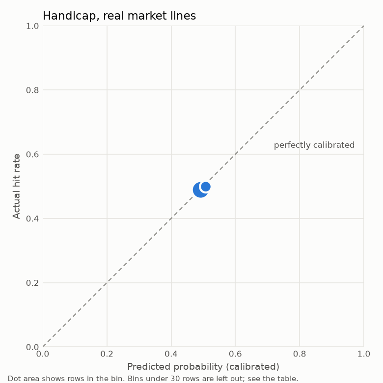
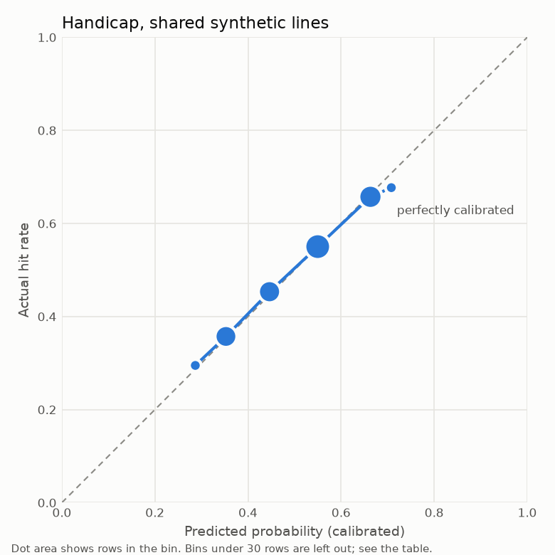
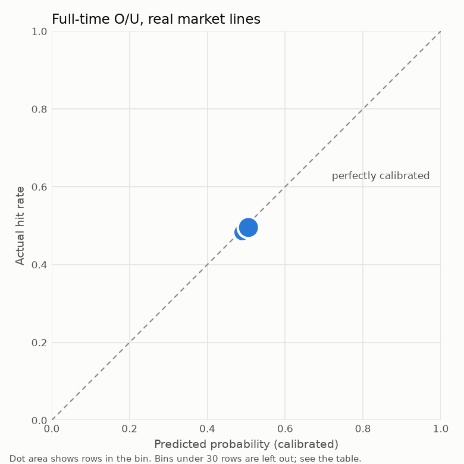
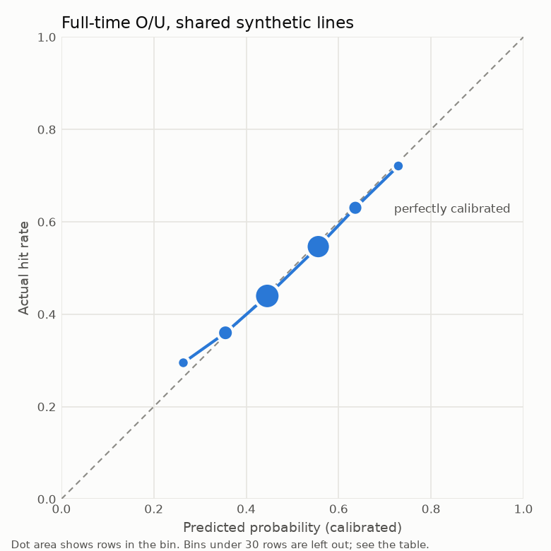
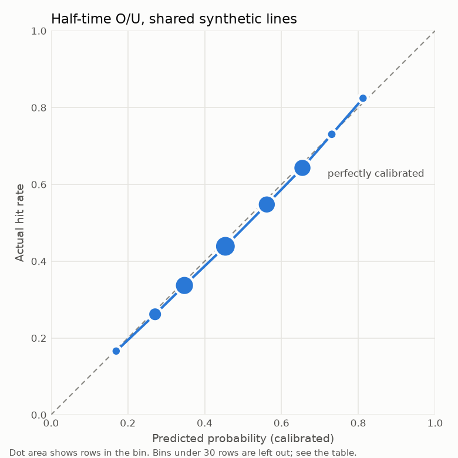
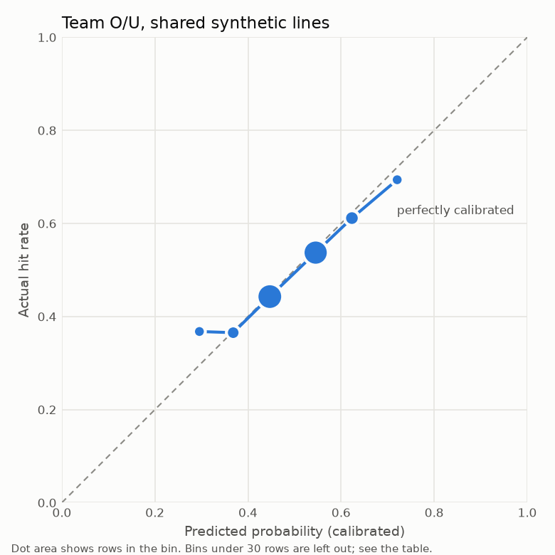

# Evidence: NCAA

Generated by `hoopsedge.backtest.run` on 2026-11-06.

## Verdict

- **NCAA Handicap:** does not beat baselines, on real market lines. Enabled anyway by owner override (D65). Gain: +0.0003 (-0.0000 to +0.0006).
- **NCAA Full-time O/U:** does not beat baselines, on real market lines. Enabled anyway by owner override (D65). Gain: +0.0002 (+0.0000 to +0.0004).
- **NCAA Half-time O/U:** beats baselines with CI excluding zero, on shared synthetic lines. Its edge over the market is unproven: history has no real lines for it (D18). Gain: +0.0081 (+0.0062 to +0.0100).
- **NCAA Team O/U:** beats baselines with CI excluding zero, on shared synthetic lines. Its edge over the market is unproven: history has no real lines for it (D18). Gain: +0.0029 (+0.0019 to +0.0039).

A positive gain means the calibrated model has lower log loss than the ratings baseline on the same games and lines, taking the baseline raw or calibrated, whichever scored better. Intervals are 95% and resample whole games. The gate only compares the model with that baseline. Beating it isn't the same as beating the market, which the market comparison below measures.

## Data

| Period | Games | With a closing line |
|---|---|---|
| 2025-26 | 6300 | 5725 |
| 2026-27 start | 303 | 150 |

- Tuning and thresholds used only games before the first tested game.
- Validation ran from 2024-10-01 to 2025-05-01, refitting every 14 days through the tested games.
- No injury features are in V1 (D15), so availability news isn't reflected.
- Half-time and team totals have no historical lines, so any edge on them is unproven until live SportyBet logs build up (D18, D27).
- Real lines are ESPN book closing lines, not SportyBet prices, whose margin may differ.
- History starts at 2023-24 (D66), so only one complete season, 2025-26, is tested. That is fewer than docs/05's three, and it can't show stability across seasons.
- `r` and `k` were chosen on 2024-25 only, before any tested game (D67).
- 2026-27 so far is a few slates, and real lines stop where the odds download stopped, so the coverage table shows how few of its games have one.
- Handicap and Full-time O/U thresholds use a floor of 1 leg per slate by owner's decision, because none met the usual 10 (D69). They can't fill a normal ticket.

## Score models, all tested games

| Period | Target | Candidate | Games | MAE | RMSE | CRPS | Log-lik. | Log-lik. gain vs baseline |
|---|---|---|---|---|---|---|---|---|
| ft | margin | model | 6603 | 9.857 | 12.638 | 7.003 | -3.9339 | +0.0266 (+0.0211 to +0.0323) |
| ft | margin | baseline | 6603 | 9.872 | 12.69 | 7.064 | -3.9605 | +0.0000 (+0.0000 to +0.0000) |
| ft | margin | elo | 6603 | 10.491 | 13.412 | 7.49 | -4.0159 | -0.0554 (-0.0635 to -0.0478) |
| ft | margin | prior | 6603 | 10.935 | 13.972 | 7.811 | -4.0571 | -0.0965 (-0.1064 to -0.0861) |
| ft | total | model | 6603 | 13.939 | 17.58 | 9.872 | -4.2854 | +0.0069 (+0.0050 to +0.0090) |
| ft | total | baseline | 6603 | 14.008 | 17.669 | 9.925 | -4.2923 | +0.0000 (+0.0000 to +0.0000) |
| ft | total | elo | 6603 | 15.668 | 19.752 | 11.097 | -4.4047 | -0.1123 (-0.1259 to -0.0978) |
| ft | total | prior | 6603 | 15.613 | 19.806 | 11.098 | -4.4104 | -0.1181 (-0.1310 to -0.1054) |
| h1 | margin | model | 6603 | 7.784 | 9.831 | 5.519 | -3.6993 | +0.0152 (+0.0114 to +0.0190) |
| h1 | margin | baseline | 6603 | 7.853 | 9.927 | 5.576 | -3.7145 | +0.0000 (+0.0000 to +0.0000) |
| h1 | margin | elo | 6603 | 7.918 | 10.03 | 5.634 | -3.7249 | -0.0104 (-0.0177 to -0.0030) |
| h1 | margin | prior | 6603 | 8.166 | 10.342 | 5.808 | -3.7556 | -0.0411 (-0.0503 to -0.0323) |
| h1 | total | model | 6603 | 8.354 | 10.545 | 5.932 | -3.774 | +0.0146 (+0.0115 to +0.0176) |
| h1 | total | baseline | 6603 | 8.48 | 10.678 | 6.015 | -3.7885 | +0.0000 (+0.0000 to +0.0000) |
| h1 | total | elo | 6603 | 9.128 | 11.501 | 6.468 | -3.8632 | -0.0747 (-0.0888 to -0.0604) |
| h1 | total | prior | 6603 | 9.031 | 11.366 | 6.406 | -3.8517 | -0.0632 (-0.0747 to -0.0514) |

### By evidence period

| Evidence period | Period | Target | Candidate | Games | MAE | CRPS |
|---|---|---|---|---|---|---|
| 2025-26 | ft | margin | model | 6300 | 9.73 | 6.91 |
| 2025-26 | ft | margin | baseline | 6300 | 9.732 | 6.958 |
| 2025-26 | ft | margin | elo | 6300 | 10.347 | 7.387 |
| 2025-26 | ft | margin | prior | 6300 | 10.828 | 7.734 |
| 2025-26 | ft | total | model | 6300 | 13.872 | 9.823 |
| 2025-26 | ft | total | baseline | 6300 | 13.937 | 9.874 |
| 2025-26 | ft | total | elo | 6300 | 15.661 | 11.08 |
| 2025-26 | ft | total | prior | 6300 | 15.622 | 11.107 |
| 2025-26 | h1 | margin | model | 6300 | 7.734 | 5.48 |
| 2025-26 | h1 | margin | baseline | 6300 | 7.786 | 5.525 |
| 2025-26 | h1 | margin | elo | 6300 | 7.839 | 5.574 |
| 2025-26 | h1 | margin | prior | 6300 | 8.099 | 5.759 |
| 2025-26 | h1 | total | model | 6300 | 8.315 | 5.906 |
| 2025-26 | h1 | total | baseline | 6300 | 8.433 | 5.983 |
| 2025-26 | h1 | total | elo | 6300 | 9.113 | 6.455 |
| 2025-26 | h1 | total | prior | 6300 | 9.028 | 6.402 |
| 2026-27 start | ft | margin | model | 303 | 12.512 | 8.944 |
| 2026-27 start | ft | margin | baseline | 303 | 12.799 | 9.263 |
| 2026-27 start | ft | margin | elo | 303 | 13.498 | 9.635 |
| 2026-27 start | ft | margin | prior | 303 | 13.166 | 9.406 |
| 2026-27 start | ft | total | model | 303 | 15.323 | 10.879 |
| 2026-27 start | ft | total | baseline | 303 | 15.487 | 10.976 |
| 2026-27 start | ft | total | elo | 303 | 15.823 | 11.458 |
| 2026-27 start | ft | total | prior | 303 | 15.42 | 10.91 |
| 2026-27 start | h1 | margin | model | 303 | 8.816 | 6.325 |
| 2026-27 start | h1 | margin | baseline | 303 | 9.243 | 6.636 |
| 2026-27 start | h1 | margin | elo | 303 | 9.577 | 6.877 |
| 2026-27 start | h1 | margin | prior | 303 | 9.553 | 6.816 |
| 2026-27 start | h1 | total | model | 303 | 9.161 | 6.474 |
| 2026-27 start | h1 | total | baseline | 303 | 9.46 | 6.676 |
| 2026-27 start | h1 | total | elo | 303 | 9.427 | 6.738 |
| 2026-27 start | h1 | total | prior | 303 | 9.106 | 6.488 |

## Markets

| Market | Lines | Candidate | Rows | Log loss raw | Log loss calibrated | Brier | Gain vs best baseline |
|---|---|---|---|---|---|---|---|
| Handicap | real | model | 5875 | 0.71624 | 0.69396 | 0.2504 | +0.0003 (-0.0000 to +0.0006) |
| Handicap | real | baseline | 5875 | 0.71607 | 0.69425 | 0.25054 | +0.0000 (+0.0000 to +0.0000) |
| Handicap | real | elo | 5875 | 0.74846 | 0.69402 | 0.25044 | +0.0002 (-0.0006 to +0.0011) |
| Handicap | real | prior | 5875 | 0.76477 | 0.69356 | 0.25021 | +0.0007 (-0.0002 to +0.0016) |
| Handicap | synthetic | model | 32522 | 0.66402 | 0.66371 | 0.23555 | +0.0017 (+0.0003 to +0.0030) |
| Handicap | synthetic | baseline | 32522 | 0.66531 | 0.66564 | 0.23643 | -0.0001 (-0.0007 to +0.0005) |
| Handicap | synthetic | elo | 32522 | 0.69865 | 0.68221 | 0.24456 | -0.0177 (-0.0205 to -0.0149) |
| Handicap | synthetic | prior | 32522 | 0.71968 | 0.68457 | 0.24572 | -0.0203 (-0.0232 to -0.0173) |
| Full-time O/U | real | model | 5875 | 0.70957 | 0.69318 | 0.25002 | +0.0002 (+0.0000 to +0.0004) |
| Full-time O/U | real | baseline | 5875 | 0.71305 | 0.69337 | 0.25011 | +0.0000 (+0.0000 to +0.0000) |
| Full-time O/U | real | elo | 5875 | 0.77323 | 0.69352 | 0.25019 | -0.0001 (-0.0013 to +0.0010) |
| Full-time O/U | real | prior | 5875 | 0.7766 | 0.69329 | 0.25007 | +0.0001 (-0.0008 to +0.0009) |
| Full-time O/U | synthetic | model | 32653 | 0.67692 | 0.67621 | 0.24163 | +0.0037 (+0.0024 to +0.0051) |
| Full-time O/U | synthetic | baseline | 32653 | 0.67995 | 0.68016 | 0.24355 | -0.0002 (-0.0005 to +0.0002) |
| Full-time O/U | synthetic | elo | 32653 | 0.74676 | 0.68664 | 0.24675 | -0.0076 (-0.0104 to -0.0047) |
| Full-time O/U | synthetic | prior | 32653 | 0.74902 | 0.68988 | 0.24836 | -0.0107 (-0.0132 to -0.0083) |
| Half-time O/U | synthetic | model | 32429 | 0.64813 | 0.64829 | 0.22828 | +0.0081 (+0.0062 to +0.0100) |
| Half-time O/U | synthetic | baseline | 32429 | 0.6574 | 0.65641 | 0.23203 | +0.0000 (+0.0000 to +0.0000) |
| Half-time O/U | synthetic | elo | 32429 | 0.69632 | 0.66635 | 0.23692 | -0.0114 (-0.0160 to -0.0067) |
| Half-time O/U | synthetic | prior | 32429 | 0.69484 | 0.66991 | 0.23855 | -0.0147 (-0.0186 to -0.0105) |
| Team O/U | synthetic | model | 65307 | 0.68118 | 0.68102 | 0.24399 | +0.0029 (+0.0019 to +0.0039) |
| Team O/U | synthetic | baseline | 65307 | 0.68391 | 0.68418 | 0.24554 | -0.0003 (-0.0005 to -0.0000) |
| Team O/U | synthetic | elo | 65307 | 0.73768 | 0.68863 | 0.24775 | -0.0050 (-0.0066 to -0.0032) |
| Team O/U | synthetic | prior | 65307 | 0.74798 | 0.69152 | 0.24918 | -0.0078 (-0.0093 to -0.0065) |

## Against the market

| Candidate | Games | Margin MAE | Market | Gain over market | Total MAE | Market | Gain over market |
|---|---|---|---|---|---|---|---|
| model | 5875 | 9.297 | 8.954 | -0.3432 (-0.4214 to -0.2663) | 13.725 | 13.378 | -0.3468 (-0.4353 to -0.2591) |
| baseline | 5875 | 9.301 | 8.954 | -0.3471 (-0.4271 to -0.2689) | 13.795 | 13.378 | -0.4175 (-0.5152 to -0.3210) |
| elo | 5875 | 9.965 | 8.954 | -1.0115 (-1.1374 to -0.8893) | 15.452 | 13.378 | -2.0741 (-2.2750 to -1.8609) |
| prior | 5875 | 10.397 | 8.954 | -1.4433 (-1.5927 to -1.2963) | 15.526 | 13.378 | -2.1482 (-2.3627 to -1.9324) |

### Picks passing the thresholds, on real lines

| Market | Candidate | Picks | Mean predicted | Hit rate | Flat return at -110 |
|---|---|---|---|---|---|
| Handicap | model | 189 | 0.5436 | +0.4286 (+0.3598 to +0.5027) | -0.1818 (-0.3131 to -0.0404) |
| Handicap | baseline | 231 | 0.5499 | +0.4113 (+0.3507 to +0.4719) | -0.2149 (-0.3306 to -0.0992) |
| Handicap | elo | 590 | 0.5359 | +0.4864 (+0.4458 to +0.5271) | -0.0713 (-0.1490 to +0.0063) |
| Handicap | prior | 646 | 0.5383 | +0.4938 (+0.4567 to +0.5341) | -0.0573 (-0.1282 to +0.0196) |
| Full-time O/U | model | 108 | 0.5273 | +0.3889 (+0.2963 to +0.4722) | -0.2576 (-0.4343 to -0.0985) |
| Full-time O/U | baseline | 129 | 0.5251 | +0.4341 (+0.3488 to +0.5194) | -0.1713 (-0.3340 to -0.0085) |
| Full-time O/U | elo | 1217 | 0.5402 | +0.5152 (+0.4881 to +0.5440) | -0.0164 (-0.0682 to +0.0385) |
| Full-time O/U | prior | 829 | 0.5381 | +0.5151 (+0.4813 to +0.5488) | -0.0167 (-0.0811 to +0.0478) |

Break-even at -110 is a 52.4% hit rate.

## Thresholds, chosen on validation only

| Market | min_prob | min_edge | Legs per slate |
|---|---|---|---|
| Handicap | 0.52 | 0.0 | 1.5 |
| Full-time O/U | 0.52 | 0.015 | 1.8 |
| Half-time O/U | 0.52 | 0.0 | 35.22 |
| Team O/U | 0.64 | 0.0 | 20.36 |

## Early season

### All games

| Bucket | Candidate | Games | Margin MAE | Margin bias | Total MAE | Total bias |
|---|---|---|---|---|---|---|
| 1-5 games | model | 1602 | 11.562 | 0.126 | 14.934 | 0.399 |
| 1-5 games | baseline | 1602 | 11.663 | 1.692 | 15.09 | 0.557 |
| 1-5 games | elo | 1602 | 12.383 | 2.339 | 16.329 | 6.099 |
| 1-5 games | prior | 1602 | 12.044 | 3.021 | 15.911 | 5.625 |
| 6-10 games | model | 998 | 10.381 | 0.182 | 13.729 | -0.307 |
| 6-10 games | baseline | 998 | 10.392 | 0.9 | 13.834 | -0.457 |
| 6-10 games | elo | 998 | 11.16 | 0.285 | 15.355 | 3.523 |
| 6-10 games | prior | 998 | 11.621 | 2.312 | 15.598 | 4.556 |
| 11+ games | model | 4003 | 9.045 | -0.75 | 13.593 | 0.001 |
| 11+ games | baseline | 4003 | 9.026 | -0.582 | 13.618 | 0.28 |
| 11+ games | elo | 4003 | 9.567 | -2.12 | 15.482 | 1.88 |
| 11+ games | prior | 4003 | 10.32 | -0.338 | 15.498 | 4.462 |
| first 14 days | model | 1133 | 12.063 | 0.671 | 15.228 | 1.016 |
| first 14 days | baseline | 1133 | 12.234 | 2.441 | 15.398 | 1.362 |
| first 14 days | elo | 1133 | 12.936 | 3.293 | 16.55 | 6.79 |
| first 14 days | prior | 1133 | 12.439 | 3.831 | 16.033 | 5.669 |

### Games with a real line

| Bucket | Candidate | Games | Margin MAE | Margin bias | Total MAE | Total bias |
|---|---|---|---|---|---|---|
| 1-5 games | model | 1169 | 10.228 | 0.049 | 14.546 | 0.506 |
| 1-5 games | baseline | 1169 | 10.303 | 1.551 | 14.723 | 0.582 |
| 1-5 games | elo | 1169 | 11.196 | 2.463 | 15.884 | 4.934 |
| 1-5 games | prior | 1169 | 10.686 | 2.447 | 15.725 | 6.535 |
| 6-10 games | model | 817 | 9.665 | -0.091 | 13.346 | -0.205 |
| 6-10 games | baseline | 817 | 9.675 | 0.657 | 13.484 | -0.341 |
| 6-10 games | elo | 817 | 10.634 | 0.436 | 14.905 | 2.542 |
| 6-10 games | prior | 817 | 10.972 | 1.711 | 15.425 | 4.822 |
| 11+ games | model | 3889 | 8.94 | -0.815 | 13.558 | 0.018 |
| 11+ games | baseline | 3889 | 8.921 | -0.648 | 13.582 | 0.314 |
| 11+ games | elo | 3889 | 9.455 | -2.142 | 15.437 | 1.626 |
| 11+ games | prior | 3889 | 10.189 | -0.484 | 15.487 | 4.51 |
| first 14 days | model | 758 | 10.444 | 0.31 | 14.766 | 1.093 |
| first 14 days | baseline | 758 | 10.566 | 2.084 | 14.96 | 1.388 |
| first 14 days | elo | 758 | 11.496 | 3.376 | 16.051 | 5.349 |
| first 14 days | prior | 758 | 10.611 | 3.003 | 15.724 | 6.62 |

## Hit rate by probability bucket

| Market | Lines | Bin | Rows | Mean predicted | Hit rate |
|---|---|---|---|---|---|
| Handicap | synthetic | 0.2-0.3 | 1845 | 0.2868 | 0.2949 |
| Handicap | synthetic | 0.3-0.4 | 6690 | 0.3526 | 0.3572 |
| Handicap | synthetic | 0.4-0.5 | 6894 | 0.4463 | 0.4533 |
| Handicap | synthetic | 0.5-0.6 | 9331 | 0.5498 | 0.5502 |
| Handicap | synthetic | 0.6-0.7 | 7567 | 0.6631 | 0.6572 |
| Handicap | synthetic | 0.7-0.8 | 195 | 0.708 | 0.6769 |
| Full-time O/U | synthetic | 0.2-0.3 | 383 | 0.2639 | 0.295 |
| Full-time O/U | synthetic | 0.3-0.4 | 4633 | 0.3551 | 0.3598 |
| Full-time O/U | synthetic | 0.4-0.5 | 12190 | 0.4456 | 0.4396 |
| Full-time O/U | synthetic | 0.5-0.6 | 11027 | 0.556 | 0.5464 |
| Full-time O/U | synthetic | 0.6-0.7 | 4248 | 0.6362 | 0.6304 |
| Full-time O/U | synthetic | 0.7-0.8 | 172 | 0.7293 | 0.7209 |
| Team O/U | synthetic | 0.2-0.3 | 87 | 0.2956 | 0.3678 |
| Team O/U | synthetic | 0.3-0.4 | 7136 | 0.3682 | 0.3653 |
| Team O/U | synthetic | 0.4-0.5 | 25338 | 0.4469 | 0.4428 |
| Team O/U | synthetic | 0.5-0.6 | 24349 | 0.5454 | 0.5373 |
| Team O/U | synthetic | 0.6-0.7 | 8232 | 0.6233 | 0.6115 |
| Team O/U | synthetic | 0.7-0.8 | 147 | 0.7206 | 0.6939 |
| Team O/U | synthetic | 0.8-0.9 | 18 | 0.8211 | 0.7778 |
| Half-time O/U | synthetic | 0.1-0.2 | 259 | 0.1696 | 0.166 |
| Half-time O/U | synthetic | 0.2-0.3 | 3572 | 0.271 | 0.2618 |
| Half-time O/U | synthetic | 0.3-0.4 | 6736 | 0.3474 | 0.3368 |
| Half-time O/U | synthetic | 0.4-0.5 | 7872 | 0.454 | 0.4388 |
| Half-time O/U | synthetic | 0.5-0.6 | 6032 | 0.5618 | 0.5477 |
| Half-time O/U | synthetic | 0.6-0.7 | 6059 | 0.6546 | 0.643 |
| Half-time O/U | synthetic | 0.7-0.8 | 1751 | 0.731 | 0.7304 |
| Half-time O/U | synthetic | 0.8-0.9 | 148 | 0.8125 | 0.8243 |
| Handicap | real | 0.4-0.5 | 4098 | 0.492 | 0.489 |
| Handicap | real | 0.5-0.6 | 1764 | 0.5078 | 0.4989 |
| Handicap | real | 0.6-0.7 | 13 | 0.6151 | 0.3077 |
| Full-time O/U | real | 0.4-0.5 | 2456 | 0.4897 | 0.4829 |
| Full-time O/U | real | 0.5-0.6 | 3419 | 0.5057 | 0.4955 |

## Reliability diagrams

## Distribution form, chosen on validation only

- Distribution: **normal**. Empirical CRPS gain: margin +0.0208 (+0.0110 to +0.0303), total -0.0019 (-0.0163 to +0.0122).
- Overtime: **absorbed in the means**. Mixture log-likelihood gain on totals +0.00261 (+0.00052 to +0.00510), with overtime adding 17.49 points. It passed on validation, but only the absorbed form is implemented (D68).

## Feature importance, full-game home points

| Feature | Gain share | Mean absolute SHAP (points) |
|---|---|---|
| efg_matchup_h | 0.0772 | 0.135 |
| adj_d_h | 0.0341 | 0.121 |
| efg_d_a | 0.0386 | 0.12 |
| exp_ppp_a | 0.0328 | 0.101 |
| days_since_start | 0.1062 | 0.094 |
| exp_ppp_1h_a | 0.0377 | 0.078 |
| exp_ppp_h | 0.059 | 0.056 |
| ftr_d_h | 0.0242 | 0.053 |
| form_a | 0.0332 | 0.05 |
| rest_a | 0.0396 | 0.049 |
| efg_matchup_a | 0.026 | 0.048 |
| orb_matchup_a | 0.0337 | 0.047 |
| exp_poss_1h | 0.0191 | 0.039 |
| ftr_matchup_a | 0.016 | 0.03 |
| efg_d_h | 0.0167 | 0.024 |

## Model

Artifact version: `20261106-1953-4d25ce0`.
